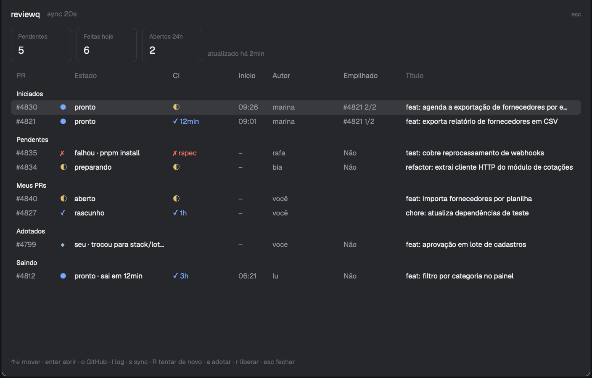

# herdr-app-reviewq



A macOS daemon that turns your GitHub review queue into ready-to-use spaces in the [Herdr app](https://herdr.dev), plus a Herdr app mod that shows the queue.

This is a port of [cirdes/herdr-reviewq](https://github.com/cirdes/herdr-reviewq), which targets the `herdr` terminal multiplexer, to the Herdr desktop app (`herdr-app` and herdr-core, `hc`). The daemon, the GitHub sync and the safety guarantees are the same; what changed is how it opens spaces, detects agents, notifies you and shows the panel.

> **Desktop support is coming to the original.** [cirdes/herdr-reviewq#7](https://github.com/cirdes/herdr-reviewq/pull/7) adds a `backend = "herdr-app"` option to cirdes/herdr-reviewq, so one install serves both the terminal and the desktop app, with the original TUI as the panel in a desktop space. Once that PR is merged, prefer the original; what stays specific to this repo is the mod (the status bar counters, the toasts and the panel drawn as a native dialog).

When someone requests your review on a pull request, reviewq creates a git worktree for the PR, opens it as a Herdr space and runs the repo's setup commands (`mise install`, `bundle install`, `pnpm install`, and so on). You get a toast when the worktree is ready. Once the PR leaves your queue (you reviewed it, or it was closed or merged), reviewq waits for a grace period and then removes the worktree, but only if you never touched it.

> The panel and messages are in Portuguese.

## How it works

- **What it tracks.** Pull requests where your review was requested directly. It ignores PRs from forks and requests made only to a team you belong to.
- **Polling.** The daemon checks GitHub through the `gh` CLI every `poll_interval_secs` (60 s by default).
- **New request.** It creates a worktree on the PR's branch (`git worktree add`, never `--force`), opens a space for it and runs the setup steps. Each step has its own timeout, and the output is saved to a redacted per-PR log.
- **Spaces work with the window closed.** A space is born in herdr-core: the daemon starts a shell in the worktree with `hc run --keep --label herdr.space=<id>`, and the Herdr app shows it as a space as soon as the window is open. The id is derived from the worktree path, so the daemon and the CLI always find the same space. With the window open, the space is named `#<n> <title>`; otherwise it is named after the worktree folder until you focus it from the panel.
- **New commits.** When the PR gets new commits, it updates the worktree with `git reset --keep`, which refuses to overwrite local changes.
- **PR leaves your queue.** It waits `remove_grace_secs` (15 min by default), closes the space, then removes the worktree and the local branch it created. If the review is requested again later, the worktree comes back.
- **Work started.** When a Claude Code or Codex session runs inside a review worktree, reviewq records the time and the agent, read from `hc ls` and `hc get`. The time is the first check (every `poll_interval_secs`) that saw it. This is informational only: it doesn't protect the worktree from removal.
- **CI, stacks and your PRs.** Every `poll_interval_secs` reviewq also reads the CI status of each tracked PR, the open PRs of each repo (to detect stacked PRs), your open PRs in the configured repos and how many PRs you created in the last 24 hours. This runs after the review sync, with a 30-second budget, and it never changes worktrees.
- **Notifications.** The Herdr app has no notification command, so the daemon appends each notice to `~/.local/state/herdr-app-reviewq/notifications.jsonl` and the mod shows it as a toast. Clicking a "ready" toast shows that PR's space.
- **Your own work is safe.** If you commit, switch branches or edit files in a worktree, reviewq leaves it in place and shows an alert. Worktrees you moved to another branch are marked as *adopted*. You can also adopt a worktree yourself before you start working in it. Adopted worktrees are never removed automatically.

## Requirements

- macOS (the daemon runs as a launchd LaunchAgent)
- The [Herdr app](https://herdr.dev), with `herdr-app` and `hc` in `~/.local/bin` (the app creates the `herdr-app` link on first launch)
- The [GitHub CLI](https://cli.github.com), authenticated: `gh auth login`, then `gh auth setup-git`
- Rust and cargo, to build the binary
- A local clone of every repo you review
- Whatever your setup commands need, for example [mise](https://mise.jdx.dev)

## Install

1. Create the config:

   ```sh
   mkdir -p ~/.config/herdr-app-reviewq
   cp config.example.toml ~/.config/herdr-app-reviewq/config.toml
   ```

   In `[[repos]]`, set each repo's `name` (`owner/repo`), the `path` to your local clone and its `setup` commands. In `disposable_ignored`, list the ignored paths your setup creates (such as `node_modules` or `vendor/bundle`). These are the only ignored files reviewq may delete along with a worktree. Unknown config keys are an error.

2. Build and install the daemon:

   ```sh
   cargo build --release
   ./target/release/herdr-app-reviewq service install
   ```

   This copies the binary to `~/.local/bin/herdr-app-reviewq` and registers and starts the LaunchAgent `dev.jacksonpires.herdr-app-reviewq`.

3. Add the mod to the Herdr app. Link it, so `git pull` updates it:

   ```sh
   ln -s "$PWD/mods/reviewq" ~/.config/herdr-app/mods/reviewq
   herdr-app check ~/.config/herdr-app/mods/reviewq
   ```

4. Give it a key and a place. In `~/.config/herdr-app/keys.json`:

   ```json
   { "global": { "cmd-shift-r": "mod.open:reviewq" } }
   ```

   For the counters and the toasts, put the mod in a status bar of a layout you own (clone a shipped one first with `herdr-app do layout.clone '{"name":"main","as":"my-main"}'`). For example, replace the `status` block at the bottom of the work column with a row:

   ```json
   { "id": "status-bar", "type": "row", "size": { "px": 28 }, "resizable": false,
     "children": [
       { "id": "status", "type": "block", "content": { "mod": "workspace-status" } },
       { "id": "reviewq", "type": "block", "size": { "px": 260 },
         "content": { "mod": "reviewq", "props": { "border": "top" } } } ] }
   ```

   Toasts only show while a bar copy of the mod is on screen.

To update, pull and repeat step 2. The mod reloads by itself.

### Coming from herdr-reviewq

The two use different paths, so they can't step on each other, but they must not run at the same time against the same worktrees. Uninstall the old daemon (`herdr-reviewq service uninstall`), copy `~/.config/herdr-reviewq/config.toml` to `~/.config/herdr-app-reviewq/` (drop `herdr_session`), and copy `~/.local/state/herdr-reviewq/state.json` and `logs/` to `~/.local/state/herdr-app-reviewq/`, setting every `workspace_id` in `state.json` to `null` (they are ids of the terminal multiplexer). Existing worktrees are kept; their spaces open the first time you focus them.

## The panel

`cmd-shift-r` (or a click on the bar) opens the panel as a dialog. The bar shows how many reviews are pending, how many worktrees are ready and how many reviews you did today.

The list has these sections, in order: **Iniciados** (pending reviews where an agent was opened, most recent first), **Pendentes**, **Meus PRs** (your open PRs, newest first), **Adotados**, **Sem sync** and **Saindo**. The counters show pending reviews, reviews done today and PRs you opened in the last 24 hours (`?` means some repo is missing or out of date).

### Columns

| Column | What it shows |
|---|---|
| `PR` | The PR number (`#123`), or `owner/repo#123` when more than one repo is configured. |
| icon | The worktree: `●` ready, `◐` being created or set up, `✗` setup failed, `⊘` blocked, `○` being removed, `◆` adopted by you. In **Meus PRs** it is the CI icon instead. |
| `Estado` | The worktree state in words (`pronto`, `preparando`, `falhou · <step>`, `bloqueado · <reason>`, `removendo`), with extra detail where it matters: `sai em Nmin` for a PR leaving your queue, `seu · <reason>` for an adopted worktree, `GitHub sem sync` when the last sync for that repo failed. In **Meus PRs**: `aberto` or `rascunho`. |
| `CI` | The CI of the PR's latest commit on GitHub: `◐` running, `✓` passed and how long ago, `✗` failed and the first failing check, `?` not known for the current commit. |
| `Início` | When you started working on it: the first time an agent was seen in the PR's worktree, as `HH:MM` today or `dd/mm` on other days. `–` until that happens. |
| `Autor` | The PR author. `você` in **Meus PRs**. Hidden when the panel is narrow. |
| `Empilhado` | Whether the PR is stacked: `Não`, or `#<bottom PR> i/n` for its position in the stack. Hidden before `Autor` when the panel is narrow. |
| `Título` | The PR title, with whatever width is left. |

### Keys

| Key | Action |
|---|---|
| `↑` `↓` / `k` `j` | Move the selection (a click selects too) |
| `enter` | Show the PR's space, opening one if it was closed. On your own PRs, open the PR in the browser |
| `o` | Open the PR in the browser |
| `l` | Open the PR's setup log in a new tab |
| `s` | Sync now |
| `R` | Retry (managed PRs only, when setup failed or the worktree is missing) |
| `a` | Adopt the worktree (asks for `y`/`n`) |
| `r` | Release an adopted worktree (asks for `y`/`n`) |
| `esc` / `q` | Close |

## Command line

| Command | What it does |
|---|---|
| `herdr-app-reviewq status` | Pending, ready and adopted PRs with CI, work start and stack position, today's count, PRs opened in the last 24 hours, your open PRs and alerts |
| `herdr-app-reviewq panel` | The panel's view as JSON (what the mod draws) |
| `herdr-app-reviewq focus pr --pr owner/repo#123` | Show a PR's space, opening one if needed |
| `herdr-app-reviewq focus first-ready` | Show the oldest PR that is ready for review |
| `herdr-app-reviewq request sync` | Check GitHub now |
| `herdr-app-reviewq request retry --pr owner/repo#123` | Rerun a failed setup, or recreate a missing worktree (managed worktrees only) |
| `herdr-app-reviewq request adopt --pr owner/repo#123` | Mark a worktree as yours before you work in it |
| `herdr-app-reviewq request release --pr owner/repo#123` | Hand an adopted worktree back. Only works if it is clean and everything is pushed. |
| `herdr-app-reviewq service restart` | Restart the daemon, for example after editing the config |
| `herdr-app-reviewq service uninstall` | Remove the LaunchAgent |

Logs live in `~/.local/state/herdr-app-reviewq/`: `daemon.log`, plus one redacted setup log per PR under `logs/`.

## Safety guarantees

- **Only pristine worktrees are removed, and only after the grace period.** Pristine means:
  - same branch and commit that reviewq checked out;
  - no tracked changes and no new files;
  - no ignored files outside `disposable_ignored`.
- **No destructive git commands.** reviewq never runs `reset --hard`, `clean` or `--force`. Updates use `reset --keep`.
- **Local branches are deleted only when reviewq created them**, they still point at reviewq's commit and no other worktree has them checked out.
- **Backups before changes.** Before any reset or removal, the previous commit is saved under `refs/reviewq/backup/pr-<n>/<timestamp>` and kept for 14 days.
- **Failures fail safe.** A failed GitHub query never removes anything, and a failure to save state stops the cycle.
- **Diffs match GitHub's.** reviewq fetches the PR's base branch (`baseRefName`; for a stacked PR, the branch of the PR below it) into `origin/<base>` when it creates the worktree, on every push by the author and whenever GitHub retargets the PR. Local branches, like the clone's `main`, are never touched, so compare against `origin/<base>`, not `main`.
- **reviewr opens on the right base.** In each worktree, the base is stored as the reviewr base pick (ref `refs/worktree/reviewr/base-pick`, read by the `persiyanov.reviewr` herdr plugin). A base you pick yourself is never overwritten.
- **Removing a worktree closes its space.** Its terminals are ended (`hc kill`), which also ends an agent still open there; a worktree is only removed when it is pristine.

## Development

`cargo test` runs the suite. The README screenshot uses made-up data:

1. `cargo test --lib readme_screenshot -- --ignored` writes `assets/demo-panel.json`.
2. Open the panel on that file in a tab: `herdr-app do tab.new "{\"name\":\"reviewq demo\",\"mod\":\"reviewq\",\"props\":{\"panel\":true,\"demo\":\"$PWD/assets/demo-panel.json\"}}"`.
3. `herdr-app shot`, crop the pane and save it as `preview.png`. Crop out the sidebar and other panes: they show your real spaces.

## License

MIT. Based on [cirdes/herdr-reviewq](https://github.com/cirdes/herdr-reviewq).
